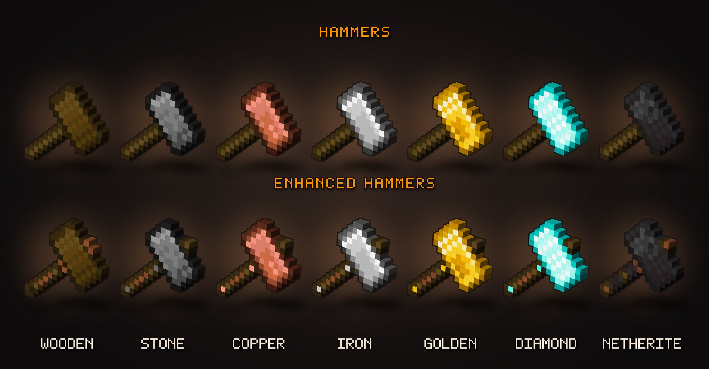

Hammers that break a whole <b>3x3</b> with every swing, plus 7 hammer-only enchantments. 
<b>Forge</b> · <b>NeoForge</b> · <b>Fabric</b> &nbsp;|&nbsp; Minecraft 1.12.2 all the way up to 26.1.2

<a href="https://www.curseforge.com/minecraft/mc-mods/hammers-extension"><b>CurseForge</b></a> &nbsp;·&nbsp;
<a href="https://modrinth.com/mod/superior-hammers"><b>Modrinth</b></a> &nbsp;·&nbsp;
<a href="https://discord.gg/tP9PZvUNjW"><b>Discord</b></a>

---

This is the place to **report bugs** and **suggest new stuff** for Hammers 3x3!
The mod itself is downloaded from CurseForge or Modrinth - there's no code here.

<table>
<tr>
<td width="50%" valign="top">

### 🐛 Found a bug?

**[Report it here →](../../issues/new?template=bug_report.yml)**

The form asks for your Minecraft version, loader and what happened. A crash log or `latest.log` helps a ton!

</td>
<td width="50%" valign="top">

### 💡 Got an idea?

**[Suggest it here →](../../issues/new?template=suggestion.yml)**

New hammers, enchantments, tweaks - anything that would make mining with hammers more fun.

</td>
</tr>
</table>

Before you post, give the [open issues](../../issues) a quick look - maybe someone already reported it. If so, leave a 👍 on it instead.
Just have a question? [Discord](https://discord.gg/tP9PZvUNjW) is the fastest way to reach me.

---

## Supported versions

| Loader | Minecraft |
|---|---|
| **NeoForge** | 26.1.2 · 1.21.8 · 1.21.4 · 1.21.1 · 1.20.6 · 1.20.4 |
| **Fabric** | 26.1.2 · 1.21.8 · 1.20.1 (needs Fabric API) |
| **Forge** | 1.20.1 · 1.19.4 · 1.19.2 · 1.18.2 · 1.17.1 · 1.16.5 · 1.12.2 |

Older versions get bug fixes when it's possible, but new features land on the newest versions first.

---

## Where to find the logs

| | |
|---|---|
| **Crash** | `.minecraft/crash-reports/` - the newest file |
| **Anything else** | `.minecraft/logs/latest.log` |

Using a launcher like CurseForge, Prism or Modrinth App? Open your instance folder and the files are in the same place.
Big logs are easiest to share through [mclo.gs](https://mclo.gs) - just paste the link.

---

Made by <b>Marvvinekk</b> · <a href="https://www.curseforge.com/members/marvvinekk/projects">More of my mods</a> · <a href="https://ko-fi.com/marvvinekk">Ko-fi</a> 
Hammers 3x3! is All Rights Reserved. Feel free to use it in modpacks!

